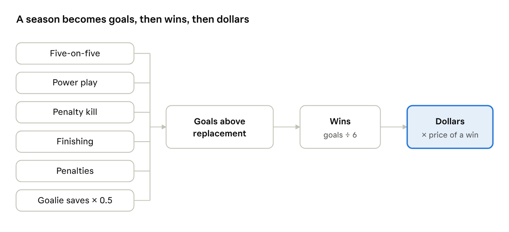

# Stats-Zor: Executive Overview

November 17, 2026. A high-level summary of the site. For every formula and its limits, see the site's [How it works](https://ciiiv.github.io/Stats-Zor/about.html) page; for how to run things, see the [README](../README.md); for the build process from the code side, see [BUILD.md](BUILD.md); for the checks the site is tested against and what they found, see [CHECKS.md](CHECKS.md).

## What Stats-Zor is

Stats-Zor is a free NHL analytics site for skaters and goalies, at [ciiiv.github.io/Stats-Zor](https://ciiiv.github.io/Stats-Zor/). Its niche is finding players who do more than the box score shows: elite work in bad situations, weak linemates or tough minutes, without full credit.

It is a static site on GitHub Pages: no server, no database and no AI running when someone visits. Each night a scheduled job rebuilds the data files, and the pages do all the math in the visitor's browser. Every formula and its limits are written out on the public How it works page.

## Data and the nightly pipeline

The data comes from two free sources: the NHL's public APIs (games, rosters, shift charts, play-by-play, EDGE skating and shot speeds) and MoneyPuck (shot-by-shot expected goals, used non-commercially with credit on every page). No contract data is collected; cap hits are typed in by the user and stay in their browser.

At 12:17 UTC each night, GitHub Actions runs nine Python scripts in order, each building on the last, and commits the results as JSON files. If one step fails, the rest still run and the site keeps yesterday's numbers for that part.

| Step | Script | What it builds |
| --- | --- | --- |
| 1 | build_data | Player seasons, careers, rosters, the search index |
| 2 | build_shots | Shot maps by location |
| 3 | build_usage | Ice time, deployment and zone starts; team game-by-game lineups and head coaches |
| 4 | build_edge | NHL EDGE skating and shot-speed tracking |
| 5 | build_box | Box-score detail (EV/PP/SH, assists, attempts, GWG/OT/shootout, plus/minus) and faceoffs by zone |
| 6 | build_disc | Penalties drawn and taken, fights, instigators and misconducts |
| 7 | build_goalies | Goalie seasons, saves above expected |
| 8 | build_impact | Isolated impact (the shift-by-shift model) and quality of competition |
| 9 | build_value | Wins above replacement, dollar value, projections |

## The skater page

The skater page compares any two players on any season since 2008-09 (default: Seider vs. Makar), in four parts that match the tabs at the top of the page. Every score is a percentile within the player's position group (forwards or defensemen), and blue is always good.

| Part | Sections | What it answers |
| --- | --- | --- |
| 1 · How he played | The season card, two-way composite, stat board, head to head, shot environment and deployment, isolated impact, shot maps, linemates and partners, team swap | What he did and how much of it is his own: points, ice time, shot share, offense and defense scores, EDGE speed, the team around him, who he played with, and where shots happened |
| 2 · How he's used | Role and fit, team deployment card | Who he faces and plays with, and whether his coach uses him well |
| 3 · What he's worth | Value and worth, fair-value contract | Wins above replacement, his dollar value this season and over three seasons, and a fair contract by age |
| 4 · Vs. history | Against history, career vs. career, career arcs and comps | Where his season sits all-time and which past players had similar careers |

Each player card also has a box score detail block: goals and points by situation, primary and secondary assists, shots against attempts, shooting next to expected, penalties drawn and taken, faceoffs by zone, and a "for the record" line (game-winning, overtime and shootout goals, plus/minus) labeled as mostly luck. A "Big nights" line adds hat tricks, multi-point games and point and goal streaks (current ones too), for the season and his career since 2008-09.

Each section head links to its explanation on the How it works page, and one broken section never takes down the rest of the page.

## The goalie page

The goalie page has the same four parts, built around one question: how many goals did he stop beyond what an average goalie would have stopped on the same shots (default: Vasilevskiy vs. Shesterkin)? It adds a shot map of the shots he faced, a goalie swap onto another team, workload and fit, and his form through the season.

Goalie percentiles are based on team games, since no goalie plays all 82. Searching a goalie on the skater page jumps to the goalie page, and the reverse.

## Trade machine

The trade machine values both sides of a trade in wins and dollars: players, goalies, prospects and draft picks. Players count for the seasons they remain under team control, including estimated RFA years (assumed paid fair value, so they add wins but no surplus).

The site does not know contracts. Users type in cap hits and years left; anything left blank counts as this season only and is flagged. Each team can pick a plan (No preference, Contending, Bubble or Rebuilding) that weights wins by season. Trades reset on refresh, on purpose.

## Teams page

The teams page looks at one team and season at a time: how it used its players game by game, and whether that matches their results. A card shows the team's five-on-five expected-goal share and rank, its recent trend and its head coach. A trend line follows the 5v5 share over the last 10 or 20 games, with coaching changes marked.

A lineup strip shows every player's line or pair in every game, set by that night's ice time, so promotions, demotions, call-ups and injuries show up as patterns. A table then compares each regular's role with what his results and value say he could handle, with a "Last 10" column for recent moves. Small samples are labeled: the recent views describe what happened and never change a player's value.

Further down, "Who carries the team" places every player by age and wins above replacement, showing how much of the team's value comes from players 25 and under; cap hits can be typed there to compare pay with value (that page only, cleared on refresh). Goalie usage shows who started each game. Goalies appear as diamonds: they count in team totals but read as their own group. A season-by-season history since 2008-09 gives each year's 5v5 share, rank, head coaches, most valuable skater and top goalie (listed separately, as other models do).

## Scouting lists sidebar

A sidebar on both pages lists players who stand out in a specific way. Every list uses three-season numbers with minimum samples (for skaters, 1,500+ five-on-five minutes), so one hot month never makes a list.

| Skater list | Who it finds |
| --- | --- |
| Unsung | Strong isolated impact but modest points, often on a bad team, with weak linemates or against the toughest opponents (the site's original idea; Carrying is its flip side) |
| Carrying | Good points and impact on teams that sink without him |
| Shutdown | Top defensive impact against top competition |
| Breakout | Age 24 or under and improving sharply |
| Bounce | Finishers shooting well below their usual level this season |
| Special teams | Power-play-heavy scorers, five-on-five scorers with little power-play time, and the best and struggling penalty killers and power-play players compared with their own teammates (three seasons) |
| Puck play | Takeaways, careful or loose with the puck, shot blockers and hitters, adjusted for each arena's scorekeeper (three seasons) |
| Discipline | Draws penalties, undisciplined, clean physical (hits without penalties) and fighters, with instigators and misconducts (three seasons) |
| Faceoffs | Best on the draw, best and worst in their own zone, and best in the offensive zone (three seasons, 1,500+ draws or 300+ in the zone) |
| Big minutes | Heavy ice time with weak isolated results |
| Leaders | Plain five-on-five leaderboards, best and worst: expected-goal share (with a teammate comparison), own expected goals, expected goals against, forward lines and D pairs; this season (minimum grows with the season) or three seasons |

The goalie lists work the same way: Little help, Stealing games, Danger specialist, Breakout goalie, Due for a bounce, Heavy workload, and Leaders (goals saved above expected, all shots and high-danger, best and worst). Goalie lists are often short (2 to 7 names), because a goalie season is roughly half luck and the minimums are strict.

## How the value model works

The value model turns a season into goals above a replacement-level player, then wins, then dollars. It is Stats-Zor's own model, kept simple, with every step shown on the How it works page.

1. **Goals above replacement.** For skaters, five-on-five play (two thirds isolated impact, one third relative to teammates), power play, penalty kill, finishing and penalties, scaled down because on-ice goals are shared by five players. For goalies, goals saved above expected, at 60% credit for describing a season (half for projections, because a goalie season is roughly half luck).
2. **Wins.** Six goals make one win.
3. **Dollars.** A win is priced from the salary cap: skaters share 88% of the cap's spending above minimum salaries, goalies 12%.
4. **Projection and contract.** A three-season blend, weighted 3/2/1 toward the latest season, is aged forward with an age curve fitted from real data. Small samples are pulled toward an average regular.

Every player has two numbers. **Season value** describes what his season produced: it counts all the goals he scored above expected, and 60% of the goals a goalie saved, the way other public models describe a season. **Fair value** (the projection, contracts, trade machine) is cautious: finishing counts only as far as it tends to repeat (forwards keep much of their shooting talent, defensemen very little), and goalies at half credit, trusted in proportion to shots faced. So Cole Caufield's 51-goal 2025-26 shows about $19.3M of season value but about $11.4M of fair value; Quinn Hughes's cold shooting year dips his season value while his fair value stays among the league's highest. Both choices were tested against real standings since 2008-09 (CHECKS.md). For the season in progress, season value is shown at full-season pace with games played, and early in the season the card adds a note that paces swing and fair value is the steadier number.

The model prices every win the same, so top stars' fair value (about 12–15% of the cap) sits below what they now earn (Makar $20.4M). The owner chose not to add a hand-set star premium.

## Isolated impact

Isolated impact estimates each skater's own effect on scoring chances, separate from his linemates, opponents, zone starts, home ice and the score. It is the same family of method as Evolving-Hockey's RAPM, built from free data.

The model reads every five-on-five shift since 2010-11. For each stretch of play with the same ten skaters, it records the expected goals each side created. A regression then finds the offense and defense value per player that best explains all those shifts together. Players with little ice time are pulled toward average so they don't produce wild numbers.

Version 2 (November 2026) starts each season from 75% of the player's previous estimate, or from a box-score estimate for newcomers. It predicted next season about 10% better. The same method also runs on actual goals, shot attempts and the five-on-four power play. The skater page shows it next to the simpler relative numbers, not instead of them.

## Testing, rules and limits

No model number changes until a test shows the change predicts next season better on real data. Against real standings since 2008-09, team totals of the value model predict next season's points better than last season's goal differential or points (correlation 0.60 vs. 0.55 and 0.52); details in CHECKS.md. Examples: the 2/3 isolated blend, the finishing rule (11% better for forwards, 14% for defensemen) and the fitted age curve each beat the setting they replaced. The blend test reruns every night.

Standing rules:

- No small samples in lists or projections.
- No scraping PuckPedia, Natural Stat Trick or HockeyViz; no copying paid Evolving-Hockey data.
- No team logos or player photos.
- MoneyPuck credited on every page; non-commercial use only.
- Python standard library for the pipeline; plain JavaScript and hand-drawn SVG for the pages, with no frameworks. The pages use the browser’s built-in tools only, with no add-on frameworks or chart libraries.

Two scheduled check-ins report on health: a weekly check every Monday (nightly runs, data freshness, missing games, test drift) and a September upkeep check (paused workflow, new cap figures, and a yearly rerun of the value-vs-standings check, tracked over time in CHECKS.md). Known limits: no contract data, every win priced the same, goalie seasons possibly a bit under-credited when describing a single season (CHECKS.md), and 50 current-season games (one week in late October, 2 to 4 per team) missing shift charts in the NHL feed.
